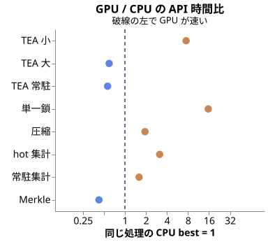

# Metal で言語を作ると、GPU に何を任せる設計になるか

<!-- persona: ../../personas/mizchi-metal.md -->

> 想定読者は、Metalic の設計意図を知り、次にどの部分を作るか判断する開発者。GPU とコンパイラの入門、インストール、論文の網羅的な紹介は省く。所要約15分。
> この資料の検査は、保存済み標本の再集計・成功時の所有期間 trace・本文と図の整合性を対象とする。GPU 性能の再測定や、実装全体の形式的な証明ではない。

**実装して最も判断が変わったのは、GPU に載る処理の種類より、CPU に戻る境界と返すデータを先に設計する必要があったことだ。** 純粋な計算として切り出せること、CPU より速いこと、アプリケーション全体が速くなることを順に分けて検査する。

## 先に持ち帰る判断

| 診断項目 | 実測値 | この実験の基準 | 判定 | 次アクション |
|---|---|---|---|---|
| 自動配置は入力に合わせられたか | 8ケース、定常766/766が許容候補 | 定常90%以上、許容費用は最小中央値の1.1倍＋10 µs以内 | OK | 既知の5アルゴリズムで継続。任意関数へ一般化しない |
| pass ごとに CPU へ戻ってよいか | 同じ63 dispatchで1.931→12.869 ms | 仕事量を揃えた協調回数の比較。普遍的な上限値は未設定 | 要対処 | 論理passとhost待機を対応させない |
| GPU parser は native CPU compiler より速いか | 同じ出力のnative CPU frontendは未測定 | 同じ構文・診断・出力で比較する | 確認 | end-to-endの高速化を主張する前に対照を作る |

最初の基準は、このプロジェクトの [fit gate](https://github.com/mizchi/metalic/blob/99eee23e12ee78428d9435b7d4d74f736da96118/src/fit.ts) が定めた許容幅で、性能評価一般の合格基準ではない。残りの節は、この3行を「表現」「同期」「回収」「CPU対照」「適応」に分けて説明する。

## 1. 小さい言語を作ると、IR の持ち方が中心になった

Metalic は UTF-8 の字句解析、固定した式文法の構文解析、関数モジュールの引数名解決と `u32`／`str` の局所的な型検査を GPU に載せた試作だ。ユーザープログラムを実行する評価器や、任意の関数を MSL に変換するコンパイラまでは作っていない。

最初の問いは「パーサを並列化できるか」だった。実装では、木をポインタで辿る前提を外し、token と AST の属性を別々の配列へ並べる SoA（Structure of Arrays）へ変えた。

たとえば文字列を一定長の chunk に分け、各 chunk が字句状態の遷移関数を計算する。関数合成の prefix scan で入口状態を求めれば、chunk の中を並列に再走査できる。式木もノード単位で構築・検査できる表現にした。

容量はソース byte 数で上から抑え、実際の token／node 件数は GPU 内で管理する。次の処理を発行するためだけに CPU が件数を読み戻す必要をなくした。代わりに、容量分の余計な lane を発行する費用は残る。

ナノパスは、各段階の入力と出力を小さく定義し、正しさを検査するために役立った。ただし、**意味上のpass境界と GPU の dispatch／host 待機の境界は別に扱う**。一つの scan を実装するために複数 dispatch が必要でも、その都度 CPU に戻る必要はない。

このやり方が一般の構文や型推論でも同じように成立するかは未検証。現在の文法、上限のある関数ヘッダ、局所的な型規則によって成立した部分を残して読む必要がある。[実装範囲とpass列](https://github.com/mizchi/metalic/blob/99eee23e12ee78428d9435b7d4d74f736da96118/README.md)

## 2. ユニファイドメモリでも、CPU に戻る依存は安くならない

shared buffer に CPU と GPU がアクセスできても、CPU が結果を使う順序は必要だった。重要なのは「何 byte 読むか」に加え、その読取りが次の GPU 仕事の発行を止めるかどうかだ。

256関数の同じ frontend を使い、63 dispatch の kernel・引数・発行範囲・最終結果を揃えた。途中で CPU が8 bytesの count を読む回数だけを増やした結果が次になる。

| host待機数 | job p50 ms | GPU区間の合計 p50 ms | 完了後のscalar読取 p50 µs |
|---:|---:|---:|---:|
| 1 | 1.931 | 1.530 | 0.000 |
| 2 | 2.227 | 1.600 | 0.167 |
| 8 | 4.752 | 2.413 | 0.917 |
| 63 | 12.869 | 0.805 | 1.750 |

毎 dispatch で CPU に戻る条件は、最後に一回待つ条件より遅くなった。ここには command buffer の分割、commit／wait、再発行や GPU scheduling の変化も含まれる。

したがって、この差を63回などで割って「Metal の一往復は一定の何 µs」とは言えない。完了後の scalar 読取り自体は累計1.750 µsだったが、この値も GPU 完了待ちと coherence 全体の費用を含む readback 時間ではない。

この経験から、CPU は I/O・版・依存関係・結果の採用を担当し、GPU 内で完結する scan／map／reduce の列はまとめて進める方針になった。小さな判断を要素ごとに CPU に問い合わせる構造では、並列計算が速くても直列の依存が増える。

アムダールの法則で心配していた直列項は、既存プログラムの状態処理だけではなかった。GPU 化のために追加した発行・待機・回収も含まれる。今回の実験から、その割合を一般のコンパイラに対して推定したわけではない。[協調回数の元記録](https://github.com/mizchi/metalic/blob/99eee23e12ee78428d9435b7d4d74f736da96118/measurements/apple-m5-cooperation-trial1.json)

## 3. 完了通知と、資源を再利用できる時点は違った

非同期化すると、GPU の完了通知だけで buffer を pool に返す設計では足りなかった。GPU が終わっても CPU がその出力を読んでいる間に、別入力が同じ arena を上書きしてはいけない。



図は成功経路の順序を示す。実装では future が buffer を所有し、GPU 完了後に CPU が結果オブジェクトを作り、arena への参照がなくなってから lease を返す。

実際の `Flight::finish` は次の順で進む。これは固定commitから抜いたコードで、概念上の疑似コードではない。

<!-- source: evidence/flight.txt -->
```cpp
    wait(); // No host reads or waits between GPU passes.
    uint64_t finished=mach_absolute_time();
    check(command.status==MTLCommandBufferStatusCompleted,
      command.error ? command.error.localizedDescription.UTF8String : "GPU command did not complete");
    auto result=consume(finished);
    consumed=true;
```

この後、batch 側が future を破棄して buffer の所有を戻す。同梱した成功時の480 traceでも、同じ slot の次の準備が前の CPU 消費終了より後であることを再検査している。

affine／linear な制約を言語に持たせたい理由も具体的になった。「一度だけ使う」に加え、非同期の仕事が終わるまで資源を保持する必要がある。ただし現状は C++ の移動専用token・lease・future で管理しており、ユーザー言語の affine 使用検査を実装・証明したものではない。

`Scheduled<Phase::CheckedAst>` は、発行を予約した能力を表す。GPU 検査の完了と同一視せず、最終 wait と診断確認の後だけ結果を公開する。[所有期間の実装](https://github.com/mizchi/metalic/blob/99eee23e12ee78428d9435b7d4d74f736da96118/native/flight.h)

## 4. GPU を速くする前に、返すものを小さくする効果が大きかった

CPU 準備、GPU 実行、別入力の CPU 回収を重ねると native batch は短縮した。一方、全 AST を返す API には CPU オブジェクト化・JSON・IPC・JS parse の費用が残った。

256関数×8入力で、同じ full 出力同士、同じ summary 出力同士を比較した値を示す。native batch は最初の準備から全結果の構築までで、API 時間には setup と JSON／IPC 等も含む。

| 出力 | slot | native batch p50 ms | API p50 ms | Metal保持容量 MiB |
|---|---:|---:|---:|---:|
| full | 1 | 68.523 | 286.365 | 4.03 |
| summary | 1 | 17.294 | 59.085 | 4.03 |
| full | 3 | 59.397 | 282.677 | 12.09 |
| summary | 3 | 10.283 | 51.209 | 12.09 |

full では native の68.523→59.397 msという改善が、API 全体の286.365→282.677 msでは小さく見える。summary は全 AST を返さず検査済み件数と診断を返すため、必要な出力自体が少ない。

full と summary の差は出力仕様の違いでもあるので、同じ処理を高速化した倍率として扱わない。また、別々の中央値を引いて JSON 単独の時間を求めることもできない。

slot を増やすと保持容量も増えた。表の容量は Metal buffer だけで RSS ではない。再利用と選択的初期化は CPU 書込み量を減らせたが、大きい pool の保持費用や入力の複製も同時に管理する必要がある。

次の言語 IR で GPU buffer を後段へ引き継げれば、全 AST の CPU 回収を減らせる可能性はある。これは今後の設計候補で、公開 GPU IR handle と、その効果の測定は未実装だ。[バッチ比較の元記録](https://github.com/mizchi/metalic/blob/99eee23e12ee78428d9435b7d4d74f736da96118/measurements/apple-m5-scheduling-trial1.json)

## 5. 純粋な処理でも、強い CPU 実装に勝つとは限らなかった

GPU 候補にできる性質と、GPU で実行する利益を分ける必要があった。特に CPU を素朴に実装すると、GPU の適性を過大評価する。

ここでの CPU best は、native 単一実行と GCD 並列それぞれの中央値のうち、小さい方を指す。64 MiBの安定 compaction は、最初は GPU が速かった。CPU の条件分岐を減らし、GCD の仕事の分け方も改善すると結論が逆転した。

| CPU実装の段階 | CPU best ms | GPU copy込み ms | CPU / GPU |
|---|---:|---:|---:|
| 分岐あり・試行1 | 8.798 | 6.336 | 1.39 |
| 分岐なし・試行5 | 2.582 | 5.488 | 0.47 |

試行間には GPU のコードや実行状態の違いもあるので、この差を CPU の一変更だけの効果とは言わない。ただし、最終的に CPU を改善して再比較しなければ「GPU 向き」と判断したままだった。[アルゴリズム比較の記録](https://github.com/mizchi/metalic/blob/99eee23e12ee78428d9435b7d4d74f736da96118/reports/CPU%20GPU%20アルゴリズムの比較検証.md)

そこで、独立 block の TEA32、小さい TEA32、単一鎖の pointer chase などを対照にした。同じ TEA32 でも、大きい入力は GPU、小さい入力は CPU を選ぶ条件ができた。

次の表は常駐 scheduler の評価で、全結果照合・JSON／IPCまで含む。直前の compaction 表はこれらを含まない native warm 時間なので、表同士で速度比を作らない。次の CPU best も、単一／GCD の API p50の小さい方だ。

| ケース | CPU best ms | GPU ms | auto ms | 定常 fit |
|---|---:|---:|---:|---:|
| tea-small | 0.033 | 0.250 | 0.050 | 100.0% |
| tea-large | 2.994 | 1.781 | 1.749 | 100.0% |
| tea-resident | 2.931 | 1.656 | 1.611 | 100.0% |
| dependent-walk | 0.051 | 0.795 | 0.063 | 100.0% |
| compact | 0.233 | 0.452 | 0.255 | 100.0% |
| histogram-hot | 0.716 | 2.252 | 0.749 | 100.0% |
| histogram-balanced | 0.952 | 1.519 | 0.993 | 100.0% |
| merkle | 12.941 | 5.497 | 5.086 | 100.0% |



auto が固定 GPU より短い行もあるが、auto も同じ手書き kernel を使う。別々の呼出し群の中央値で、OS 負荷や動作周波数も制御していないため、この差の原因は分離できていない。

単一鎖は次アドレスが直前の load に依存し、GPU 内に並列度を作れなかった。一方、多数の独立鎖を同時に辿る場合は別条件になる。histogram も分布と常駐条件で優劣が変わり、アルゴリズム名だけの配置表にはできない。

GPU 化の単位は、一関数であることより、十分な演算量・並列度・連続したアクセス・小さい回収結果を持つ領域かどうかで選ぶ必要がある。純粋性や所有権は安全に候補を作る条件で、採用は実測で判断する。

## 6. 自動配置には、計測値を疑い直す仕組みが要った

常駐 CPU／GPU worker を一つずつ用意し、登録済みの5アルゴリズムについて単一 CPU・GCD・GPU を試して配置する実行系を作った。実行中の仕事は移動せず、仕事の境界で配置する。

プロファイルは処理種類・正確な件数・実分布の特徴・入力配置ごとに保存する。binary／MSL／OS等が変われば無効化し、単独と競合の観測を分ける。現在は別 process の入力 replica を持つので、ユニファイドメモリを利用した完全な zero-copy scheduler にはなっていない。

評価は学習と別 seed を使い、固定 CPU/GPU 対照の時間を scheduler に教えない。全byte固定の hot histogram は、seed を変えても実入力が同じになる例外だ。現在の記録では8ケースの定常選択766/766が許容候補になったが、「毎回の絶対最速」や「任意のプログラムで最適」を示した結果ではない。

<!-- output: archived-lessons -->
```text
Fit: 8 cases, 768 automatic decisions, 766/766 steady competitive choices
All decisions: 766/768; max estimated regret 4.2%
Failure trial2/merkle: steady fit 0.0%, estimated regret 130.6%
Failure trial3/compact: steady fit 89.0%, estimated regret 11.0%
```

失敗の一つでは、学習時に遅かった GPU が後で速くなっても、疎な再探索2件だけでは古い中央値を更新できなかった。標本を増やす設定が、かえって古い状態を長く信じる結果になった。

採用中の費用が大きく変われば他方を再確認し、速くなった候補を見つければ連続確認する仕組みを加えた。一つの外れ値で履歴を捨てないようにしたが、積極的な探索で compaction が基準未達になる試行も保存している。

許容候補は最小 service 中央値の1.1倍＋10 µs以内、定常率の基準は90%以上だ。探索も含む推定 regret と、API p50の「固定最速の1.25倍＋20 µs以内」も別に検査する。この加算幅により小処理は1.25倍を超えても合格し、表の小 TEA もその例になる。

学習の費用も残る。最終記録の Merkle は学習だけで約312 msかかり、表の約5 msには含まれない。さらに起動・準備があり、先行 warmup の時間は保存していないため、cold 全体の損益分岐は未測定だ。[fit の全基準と失敗記録](https://github.com/mizchi/metalic/blob/99eee23e12ee78428d9435b7d4d74f736da96118/reports/CPU%20GPU%20配置の%20fit%20とチューニング.md)

## 次に作るなら

ここまでの実装は、GPU 向けの小言語 frontend と、手書きの5アルゴリズムの配置実験から成る。両者をつないで任意のユーザー関数を CPU／GPU に自動生成・配置する処理系は、これから作る部分だ。

次の優先順位は、同じ診断・出力を返す native CPU frontend、後段へ引き継げる IR と所有権、同一 native process 内での CPU/GPU 資源共有と考える。これらの性能効果は未検証で、次の比較実験の提案として区別する。

新しい pass を追加するときは、GPU 内で依存を解決できるか、CPU が必要とする最小の結果は何か、最適化した CPU 対照と同じ出力を作っているか、初回費用と保持容量を含めて有利かを確認する。MSL 4.0では今回の検証を続けられ、4.1への更新は必須にならなかった。

## 理解度チェック

<details>
<summary>1. 中間 count は8 bytesしかない。pass ごとに CPU が読んでも小さい費用で済むか。</summary>

済むとは言えない。読取りに先行する GPU 完了待ちと、次の仕事の再発行が依存経路に入る。同じ63 dispatch の比較では1.931→12.869 msとなったが、これも readback 単独の費用ではない。
</details>

<details>
<summary>2. GPU の完了通知が来た。別入力に同じ arena を渡してよいか。</summary>

CPU の消費が終わるまで渡せない。480件の成功 traceでは、前の CPU 消費終了後に同じ slot の次の準備が始まることを確認している。これは全実行や例外経路を形式証明したこととは違う。
</details>

<details>
<summary>3. compaction は純粋な scan／scatter なので、CPU より GPU が速いと考えてよいか。</summary>

純粋性は配置候補にする条件で、性能の結論にはならない。CPU の分岐や分割を改善した後の同じ出力の比較では CPU が速かった。小さい TEA と大きい TEA の違いも、入力規模を含めて測る理由になる。
</details>

<details>
<summary>4. 766/766件が許容候補なら、GPU compiler 全体の高速化を確認したと言えるか。</summary>

言えない。登録した5アルゴリズム・8入力条件の定常選択を、許容幅付きで判定した値である。探索・学習の費用、出力の回収、同じ仕様の native CPU frontendとの比較は別に判断する。
</details>

## 再検査と根拠

資料の対象は Metalic commit [99eee23](https://github.com/mizchi/metalic/tree/99eee23e12ee78428d9435b7d4d74f736da96118)、実機測定は2026-11-15の Apple M5／macOS 26.6.2／MSL 4.0。この資料の作成日は2026-11-16。

```sh
node docs/metalic-lessons/examples/verify-evidence.mjs --check-prose
node skills/explainer/scripts/verify-doc.mjs docs/metalic-lessons
node skills/explainer/scripts/build-html.mjs docs/metalic-lessons/README.md
```

同梱の [測定抜粋](evidence/measurements.json) と [再集計コード](examples/verify-evidence.mjs) だけで、表・fit 率・成功 trace の順序を検査できる。Metalic の checkout や Apple GPU はこの資料の再検査には不要。

抜粋には元のJSONのパス・固定commitのURL・ファイルSHA-256を記録した。これは元データの来歴を示すもので、省いた全データを抜粋だけから証明する仕組みではない。元checkoutを持つ場合だけ [抽出スクリプト](examples/import-evidence.mjs) で固定commitから作り直せる。

元プロジェクトには実装時の56テスト／Metal validation付き804 GPU実行の報告もあるが、ここで再実行した検査とは分ける。本文の数値は過去の標本の再計算で、現在の機種・負荷で同じ速度が出る保証ではない。

この資料の検査範囲と、読者目線で修正した点は [検証記録](verification.md) にまとめた。
